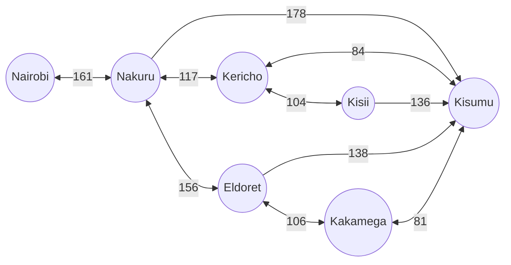
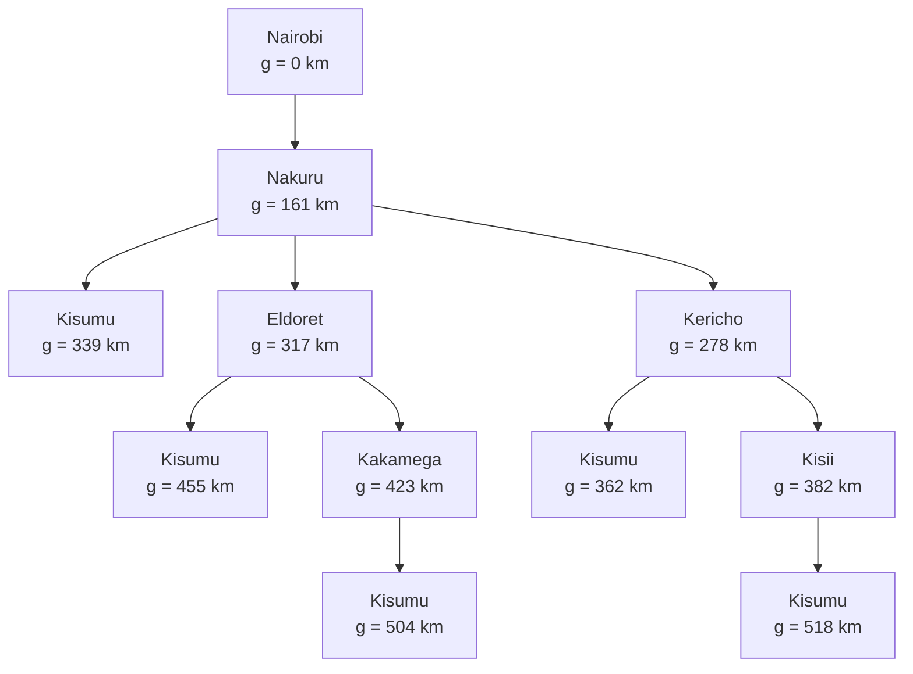

# Practical Exercise 3: Designing a Searching Agent

---

## 1. PEAS Design

### PEAS Component Summary

| PEAS Component | Details |
| :--- | :--- |
| **Performance Measure** | Safety of people, the truck and the environment (no crashes, rollovers, fuel leaks, spills or fires); safe delivery of the full fuel load with no loss or theft; on-time delivery; fuel-efficient trip; least time taken for the trip (without compromising safety); obeying traffic laws and dangerous-goods transport rules; avoiding crowded areas where possible |
| **Environment** | Roads and highways, traffic law, other vehicles, pedestrians and animals, weather and road conditions (rain, fog, slopes, sharp bends), the fuel tank and its load, fuel depots and petrol stations, loading and offloading points, security risks (hijacking or theft), the dispatcher or control centre |
| **Actuators** | Steering wheel, accelerator, brakes, gears, indicators, headlights, horn, hazard lights, emergency shut-off valves for the fuel tank, fire suppression system, alarm and display, automatic emergency call to the dispatcher or emergency services, unloading valve and pump control |
| **Sensors** | Cameras (front, rear, side), GPS, sonar/radar/lidar, speedometer, fuel level sensor, fuel temperature sensor, leak and vapour (gas) detector, tank pressure sensor, tyre pressure and brake temperature sensors, load sensor (to detect fuel sloshing and weight shifts), roll angle sensor, keyboard (to enter the destination) |

### Environment Classification

| Property | Classification | Reason |
| :--- | :--- | :--- |
| **Fully or partially observable** | Partially observable | The agent cannot see everything: vehicles in blind spots or around bends, hidden potholes, wet or oily road patches, the intentions of other drivers, and small leaks or temperature changes inside the tank that sensors may miss. Sensors can also be noisy in rain or fog, so the agent must make informed guesses. |
| **Deterministic or stochastic** | Stochastic | Many things are beyond the agent's control: other drivers, sudden braking ahead, animals crossing, weather, tyre bursts, mechanical faults and possible hijackers. The same action in the same situation can give different results. |
| **Episodic or sequential** | Sequential | Current choices depend on previous actions. Speed, braking and steering earlier change how the fuel is sloshing now, and that affects how safely the truck can turn or stop. One bad decision can limit the options afterwards. |
| **Static or dynamic** | Dynamic | The environment changes while the agent is still deciding. Traffic keeps moving, lights change, pedestrians step out and the fuel keeps shifting, so the agent must check the environment again before it acts. |
| **Single-agent or multi-agent** | Multi-agent | The truck shares the road with other agents: drivers, pedestrians, traffic police, other vehicles and automated trucks. It also deals with the dispatcher and the depot or station staff, who make their own decisions. |

---

## 2. Directed Graph and Search Tree

### Problem Formulation

| Component | Definition |
| :--- | :--- |
| **Initial State** | Nairobi |
| **State Space** | Towns connected by the selected highway network; towns are nodes and road connections are arcs. |
| **Actions** | Drive from a town to a connected town. |
| **Goal Test** | Check whether the trailer’s current state is Kisumu. |
| **Path Cost Function** | Sum of road distances between towns, measured in kilometres. |

### Abstraction

Abstraction means leaving out irrelevant information, so only the states and actions that help solve the problem are kept.

The model retains the main towns and road connections relevant to the Nairobi–Kisumu journey. Intermediate towns are omitted where they would not change the available route choices or the path cost. Low-level driving actions such as steering and braking are excluded, because the problem is choosing a route between towns. Branches that cannot improve on the best-known cost need not be expanded further.

---

### Directed Graph

> **Key:** Circle = state (town), arrow = action (drive from A to B), number = step cost (km). **Nairobi** is the start state, and **Kisumu** is the goal state.

| Directed Connection | Distance (km) |
| :--- | :--- |
| Nairobi $\rightarrow$ Nakuru | 161 |
| Nakuru $\rightarrow$ Kericho | 117 |
| Nakuru $\rightarrow$ Eldoret | 156 |
| Nakuru $\rightarrow$ Kisumu | 178 |
| Kericho $\rightarrow$ Kisumu | 84 |
| Kericho $\rightarrow$ Kisii | 104 |
| Kisii $\rightarrow$ Kisumu | 136 |
| Eldoret $\rightarrow$ Kisumu | 138 |
| Eldoret $\rightarrow$ Kakamega | 106 |
| Kakamega $\rightarrow$ Kisumu | 81 |

---

### Search Tree

The value $g(n)$ is the cumulative distance from Nairobi to node $n$.

---

## 3. Optimal Path

| Route | Working | Total (km) |
| :--- | :--- | :--- |
| **Nairobi $\rightarrow$ Nakuru $\rightarrow$ Kisumu** | $161 + 178$ | **339** |
| Nairobi $\rightarrow$ Nakuru $\rightarrow$ Kericho $\rightarrow$ Kisumu | $161 + 117 + 84$ | 362 |
| Nairobi $\rightarrow$ Nakuru $\rightarrow$ Eldoret $\rightarrow$ Kisumu | $161 + 156 + 138$ | 455 |
| Nairobi $\rightarrow$ Nakuru $\rightarrow$ Eldoret $\rightarrow$ Kakamega $\rightarrow$ Kisumu | $161 + 156 + 106 + 81$ | 504 |
| Nairobi $\rightarrow$ Nakuru $\rightarrow$ Kericho $\rightarrow$ Kisii $\rightarrow$ Kisumu | $161 + 117 + 104 + 136$ | 518 |

### Optimal Solution

The optimal path from Nairobi to Kisumu is **Nairobi $\rightarrow$ Nakuru $\rightarrow$ Kisumu**, with a total path cost of $161 + 178 = 339\text{ km}$. Going via Kericho costs $362\text{ km}$, which is $23\text{ km}$ longer. All other routes cost more.

The trailer drives Nairobi $\rightarrow$ Nakuru $\rightarrow$ Kisumu, checking its location against the plan at each stage. Intermediate towns, such as Naivasha, may be omitted from the simplified graph because the model focuses on route selection between the main towns.